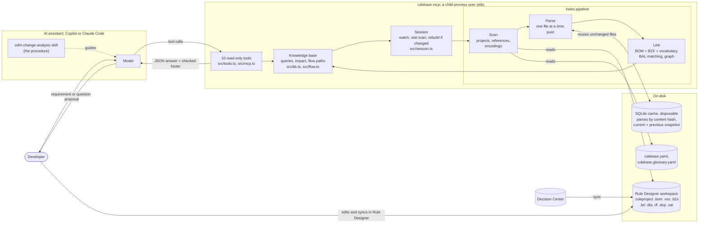

# Design

Rulebase is a local, read-only knowledge base over one IBM ODM Rule Designer workspace. A developer's AI assistant (Claude Code, Copilot, Cursor) calls it through MCP to find out what the rules actually say, which vocabulary is legal, and which rules a new requirement would touch.

Accuracy is the first priority. Every answer is either grounded in a source file or says plainly what it could not check.

This document records the decisions agreed on 2026-11-24. Each one says why, so a later change can tell what it would be undoing.

## What it is for

A requirement arrives ("decline applicants whose debt-to-income is above 40%"). The developer's assistant uses Rulebase to answer:

1. **Which existing rules or decision-table rows probably need to change**, and why.
2. **Whether a new rule is needed**, and which package and ruleflow task it must land in to actually run.
3. **Whether the vocabulary is missing something**, so a BOM change is needed before any rule can be written.
4. **What else a change touches**: same package, the ruleflow task that selects it, the operation that runs the flow, and rules that use a virtual member computed from the changed member.

Rulebase does not write rules. Writing rules is phase 2, and it will need the row- and condition-level provenance kept here.

## How it fits together



- **Read-only.** Arrows into the workspace come only from the developer and Decision Center. Rulebase reads, and writes only its own cache (D5, D8, D14).
- **Fresh on every answer.** Before a tool answers, the session checks for changes and re-parses only files whose content changed. Linking and queries then run in memory (D12, D14, D15).
- **Facts versus procedure.** The tools return facts, with a `checked` footer saying what was read. The skill tells the assistant how to use them and what to hand back (D2, D13).

## Decisions

| # | Decision | Why |
|---|---|---|
| D1 | **Local tool only.** A CLI plus a stdio MCP server, started by the assistant host. No hosted service and no background daemon. | Adoption without infrastructure. Nothing to install, monitor or secure on each machine. |
| D2 | **Reliability contract.** Deterministic output, loud failure on unparseable files (reported by path), versioned tool schemas, one-command install, explicit "I don't know". | An agent that trusts an incomplete index confidently misses rules. Silent gaps are the worst failure. |
| D3 | **Input: one Rule Designer workspace = one decision service** and its rule projects. It is read from disk after the developer syncs from Decision Center. A Decision Center REST connector comes later. | Matches how developers work: Decision Center holds rule projects and the BOM, the XOM is in git, and Rule Designer combines them. |
| D4 | **Project discovery is automatic.** Find every `.ruleproject` and follow project references. An optional `rulebase.yaml` can include or exclude projects. | Zero setup in the normal case. Stale projects can be excluded. |
| D5 | **No UI.** `rulebase report` writes a static HTML report (gates, coverage, warnings, drift) that can be published as a CI artifact. | The users are assistants and developers in their editor. The only UI need is a person checking what was indexed. |
| D6 | **Accuracy order:** parse fidelity > impact completeness > grounding precision (never accept an invented term) > grounding recall > search relevance. The first three are pass/fail gates; the last two are measured. | Each layer depends on the ones before it. |
| D7 | **The glossary is a file** (`rulebase.glossary.yaml`) committed beside the workspace and reviewed in PRs. It is loaded into memory once. | Every input that changes answers is versioned and reviewable. It costs no speed. |
| D8 | **Read-only.** | Writing BAL or decision tables back needs exact round-tripping of ODM XML. That is phase 2. |
| D9 | **Full BOM fidelity**: fully qualified class names, inheritance, statics, domains and enums, member types, and virtual members with their B2X logic. | Real BOMs use all of these. Missing terms turn into false "vocabulary gap" answers. |
| D10 | **Virtual members are legal vocabulary.** B2X is read so impact can follow a virtual member back to the members it is computed from. | Rules use virtual members like any other member. Impact must not miss rules through them. |
| D11 | **XOM is not indexed** for now. | Rules are written in BOM vocabulary. The XOM adds types and BOM–XOM mismatch checks, which is a separate problem. |
| D12 | **Branches and releases:** one index per workspace, rebuilt incrementally when files change. The footer shows the Decision Center branch when Rule Designer records it. Activities wait for the Decision Center connector. | Content-hash storage makes switching back to a branch nearly free. Drift answers "what is different on this branch". |
| D13 | **The assistant does language; Rulebase validates.** The assistant maps business language to BOM phrases using `find_terms` and `list_terms`. Rulebase validates strictly (terms, literals, operators, types) and computes candidates and impact deterministically. | LLMs are good at paraphrase and bad at knowing which terms exist. Rulebase is the reverse. Building a language engine in Rulebase would never be as good. |
| D14 | **SQLite is a disposable cache** outside the workspace (`%LOCALAPPDATA%\rulebase\` on Windows, `~/.cache/rulebase/` elsewhere). Artifacts are stored by content hash. Only the current and previous snapshot are kept. Reindex is incremental by file hash. | Everything can be rebuilt from the workspace plus committed files. The file stays small and an edit reindexes in about a second. |
| D15 | **Performance targets with no quality trade-off:** full reindex of 5,000 artifacts in under 30 s, incremental under 2 s, query p95 under 50 ms, memory under 300 MB. Expensive checks run in `rulebase check` and CI, never by skipping them. | The old pipeline took 10 minutes at 5k artifacts because the recall gate ran on every reindex, and search had no inverted index. |
| D16 | **Small responses.** Summaries plus ids, and only the matched decision-table rows. `get_artifact` returns the full document. | Assistant context is limited. |
| D17 | **TypeScript.** Accuracy comes from parse fidelity, not the language. An optional Java harness compares our parse with IBM's own parser on a machine with Rule Designer installed. | Keeps the working code. The oracle makes "parses like ODM" a measured claim. |
| D18 | **No vector search.** BM25 plus fuzzy matching (inflection, typos) plus `list_terms` browsing plus the glossary plus BOM documentation. A local embedding model is only added if the real-workspace test shows misses, and then only as an optional ranking signal, never for grounding. | Hashed vectors added nothing semantic. Browsing makes "not found" mean "does not exist". |
| D19 | **Windows first.** CI runs on Windows and macOS. Files are decoded by their declared XML encoding. Paths are stored normalized with `/`. | Rule Designer runs on Windows. A path or encoding bug would silently drop files, which breaks D2. |
| D20 | **Install from GitHub** with `npm install -g`, from the compiled `dist/` (no build at install). Move to a registry once the version is stable. A bundled `.exe` is the fallback if Node is restricted. | The repo is private. GitHub access is enough. |

## Workspace model

```text
Workspace (one Rule Designer workspace folder)
└── Decision service        the project with isADecisionService="true"
    ├── Rule project         main project plus referenced projects
    │   ├── Package          rules/<a>/<b> → a.b
    │   │   └── Artifact     action rule, decision table, decision tree, function, technical rule
    │   ├── Ruleflow         tasks, transitions, selection
    │   ├── Decision operation
    │   └── Variable set
    └── BOM entry            .bom + .voc (one locale) + .b2x
        └── Class            fully qualified, extends/implements
            └── Member       attribute / method / constructor, type, static, virtual, domain
                └── Phrase   navigation / action verbalization, instantiated
```

Every node keeps its provenance: project, workspace-relative path, UUID, and the content hash of its source file.

## Tools (MCP)

All tools are read-only, and every answer ends with a `checked` footer (D2). The list, and what each tool returns, is in [REFERENCE.md](REFERENCE.md#tools).

## Quality gates (`rulebase check`, CI)

- Every file with a known extension is parsed, or reported by path with the reason.
- Every rule artifact has a UUID and a path.
- Every ruleflow selection resolves to a package or rule that exists.
- Every decision table has rows. The row count matches a direct count of action sets.
- Every operation input binds to a variable-set parameter.
- Every verbalization resolves to a BOM member of a known class.
- Every virtual member has B2X logic, or a warning says it does not.
- Recall@5 by own name ≥ 95%.
- With the IBM oracle available: term usage, row counts and selection agree exactly.

## Not in phase 1

- Writing rules or tables.
- The Decision Center REST connector and activities.
- Comparing two branches directly (drift across a reindex covers the common case).
- XOM indexing.
- Embeddings.
- A hosted or multi-user service.

## Status

Every decision above is built, except the IBM-parser comparison (D17) and the items under "Not in phase 1". Measured coverage and performance against D15 are in [REFERENCE.md](REFERENCE.md#accuracy).

## Known risks

- **No large private workspace has been indexed yet.** The biggest public decision service has 35 rules, so scale has only been measured on synthetic data. `rulebase anonymize` exists so a real workspace can be tested without its business content leaving the machine. It verifies that the copy indexes the same way.
- **BAL term usage is resolved by matching instantiated phrase patterns,** not a full BAL grammar. On the corpus, 3 uses are still not typed: arithmetic inside a phrase, and French `a` used as the verb "has". The IBM oracle comparison (D17) is how the remaining mismatches will be found.
- **Rule languages are limited to English, French, Portuguese and Spanish.** The word lists live in `src/text.ts` and `src/bal.ts`, and the "New BAL language" recipe in `.github/copilot-instructions.md` says how to add one.
- **Java (XOM) method bodies are not read** (D11). Impact follows B2X-implemented members to the fields they read, but not Java-implemented methods. A rule calling "the customer is eligible" isn't flagged when a field the Java method reads changes.
- **Other IBM decision products** (ADS, DSI rule agents) share the project layout. They are detected and reported as unsupported, not read.
